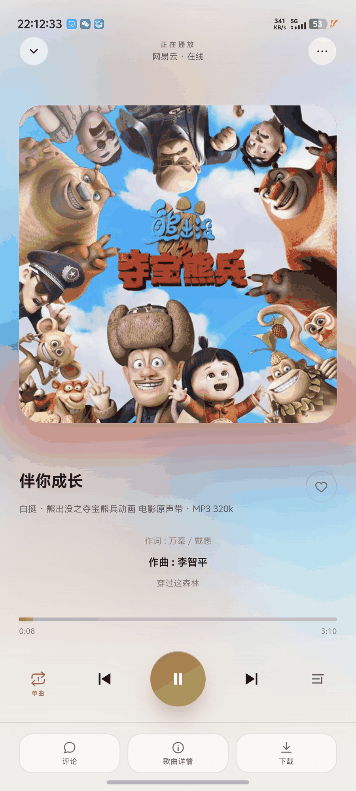
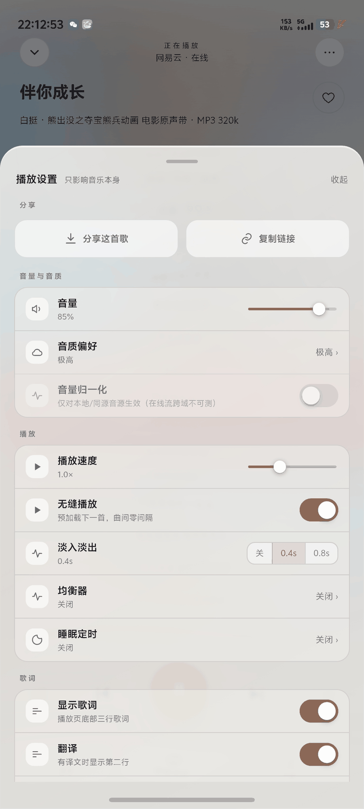
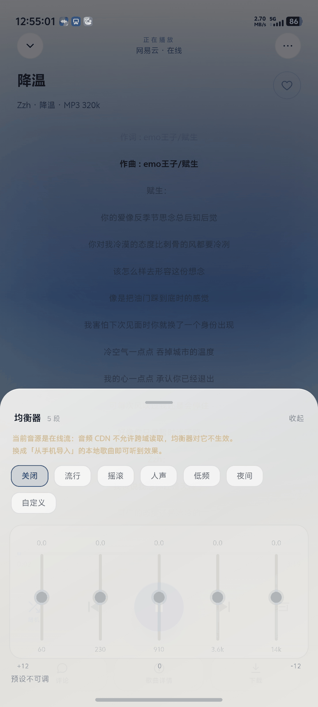
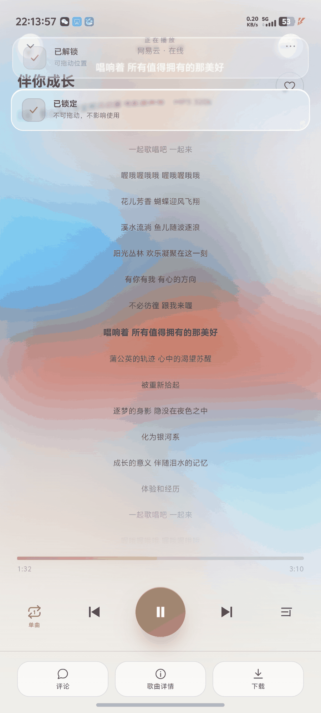
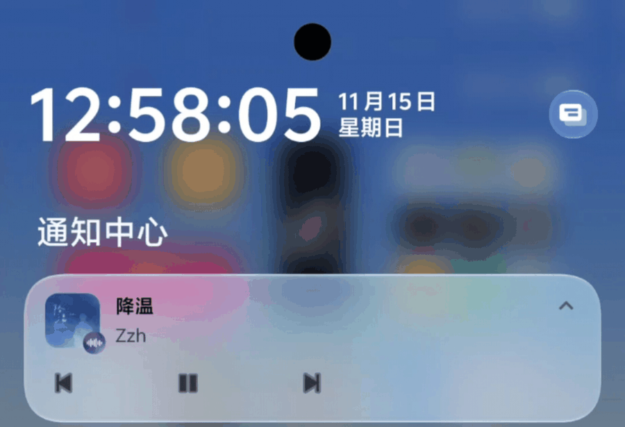

# Ripple 涟漪

> 一个会呼吸的 Android 音乐播放器。液态玻璃单套观感，深色 / 浅色双主题，封面自动取色。
> 在线内容走网易云真实接口（weapi 加密），支持登录自己的账号、每日推荐、心动模式与无限漫游。

<p align="center">
  <b>PWA + 原生外壳</b> · <b>0.67 MB</b> · <b>无 Gradle 依赖</b> · <b>无 AndroidX</b> · <b>MIT</b>
</p>

---

## 它长什么样

| 首页 | 播放页 |
|:---:|:---:|
|  |  |

| 完整歌词 | 播放设置 |
|:---:|:---:|
|  |  |

| 均衡器 | 状态栏歌词 |
|:---:|:---:|
|  |  |



> 真机截图：vivo V2425A / Android 17。通知与原子岛由系统按 MediaSession 渲染。

## 特点

**播放**

- 双 `<audio>` 元素架构：在线流直连解码（避开 CORS 污染），本机导入走 WebAudio（可接均衡器）
- 多尺寸适配：小屏手机 / 常规手机 / 大屏手机 / 折叠屏 / 平板 / 桌面各有一套布局，支持小窗与分屏
- 淡入淡出、播放速度、睡眠定时（跨重启恢复）、无缝预加载、音量归一化
- 断点续播：退出后重进自动恢复上次的歌与进度，**歌词也会一起恢复**

**界面**

- 单一「液态玻璃」观感。不搞多套皮肤 —— 一套做透
- edge-to-edge 全屏：状态栏 / 导航栏透明，颜色跟着页面背景和封面主色走
- 播放页三行歌词（点开是完整歌词），封面动态取色，VIP 角标
- 右上角「…」是所有播放相关设置的入口，不必绕回「我的」
- 评论加载骨架屏，不闪不跳

**均衡器**

- 5 段（60 / 230 / 910 / 3.6k / 14k Hz），6 组预设 + 自定义（±12 dB）
- 预设模式下竖条置灰不可动；切到「自定义」才能拖

> 均衡器只对**本机导入**的歌曲生效。在线流走直连解码（网易云音频 CDN 不返回 CORS 头，
> 强行接进 WebAudio 会被判污染并静音），播在线歌时面板会明确提示，不会假装有反应。

**通知与状态栏**

- 前台服务 + MediaSession：通知固定不可滑掉，锁屏可控、耳机键可控
- 状态栏歌词悬浮窗：颜色（含自绘取色器）、字号、不透明度、加粗、描边、
  **跟随播放进度填充**
- **锁定态完全不拦触摸**，不影响你正常用手机；解锁后才能拖动位置

**网易云**

- 真实 weapi 协议（AES-128-CBC 双层 + textbook RSA，与主流第三方客户端一致）
- 内置登录页（扫码 / 账号密码），登录态持久化
- 搜索、歌曲详情、歌词（含翻译）、播放地址自动降级、排行榜、歌单、
  每日推荐、我喜欢、心动模式、无限漫游、评论

## 不做什么

为了不给自己惹麻烦，这些不做：

- **不内置任何音乐资源**，不提供下载站
- **不绕过会员、付费或地区限制**。取不到音源就明确告诉你取不到
- 不承诺通知栏长得像某个 App —— 外观由系统按 MediaSession 渲染，厂商主题说了算

## 安装

### 装 APK（推荐）

到 [Releases](../../releases) 下载最新的 `Ripple-x.y.z.apk`，传到手机安装（需允许「安装未知来源应用」）。

- 最低 Android 7.0（API 24）
- 装完直接可用，**不需要另起服务、不需要配置接口地址**

### 跑网页版 / PWA

```bash
node server.js          # 默认 8080
```

终端会打印局域网地址，手机连同一 Wi-Fi 后访问 `http://<你的IP>:8080`，
浏览器菜单里「添加到主屏幕」，即可全屏运行。

> 由 `server.js` 托管时页面自动走同源 `/ncm/*` 代理，**不需要手填接口地址**。
> 只有想连别的自建接口时才需要在「我的 → 网易云接口地址」里填。

### 从源码构建

```bash
export ANDROID_HOME=/path/to/android-sdk
export JAVA_HOME=/path/to/jdk17+
bash android/build-apk.sh
```

产物：`android/build-manual/Ripple-<版本>-debug.apk`。
详细的环境要求与 ARM 机器的坑见 [BUILD-ANDROID.md](BUILD-ANDROID.md)。

## 项目结构

```
app/                    ← 网页版，同时是 APK 里的 assets/www
├── index.html
├── css/                ← base（令牌/主题/播放页）/ layouts / components
├── js/
│   ├── version.js      ← 构建时生成，勿手改
│   ├── log.js          ← 日志（含原生化）
│   ├── lrc.js          ← LRC 解析与双语合并
│   ├── netease.js      ← 网易云客户端（native / proxy 双通道）
│   ├── store.js        ← 状态、本地曲库、IndexedDB
│   ├── player.js       ← 播放引擎
│   └── app.js          ← 界面与业务
└── sw.js               ← Service Worker

android/                ← Java 外壳（8 个类，见 BUILD-ANDROID.md）
server.js               ← 浏览器模式的本地服务（静态 + /ncm 代理）
version.json            ← 版本号唯一来源
```

## 隐私

**没有自有服务器，不上传任何数据到第三方。** 所有网络请求只发往 `music.163.com` 及其 CDN。

| 数据 | 存在哪 |
|---|---|
| 网易云登录态 | APK：应用私有配置；浏览器模式：`.ripple-cookie`（权限 0600，但 Android 外部存储不实现 POSIX 权限位，实际不生效） |
| 本机导入的音频 | IndexedDB / 应用私有目录 |
| 播放记录、设置 | localStorage / SharedPreferences |
| 运行日志 | `Download/Ripple-log.txt`（不含密码） |

`.ripple-cookie`、`.ripple-token` 都在 `.gitignore` 里，不会被提交。

> **关于 0600 的说明**：本项目常跑在 `/sdcard/DSHBox/ripple`（Android 内部存储，
> fuseblk 挂载）。该挂载不实现 POSIX 权限位，`chmod 0600` 是空操作。
> 服务启动时会读回文件 mode 校验，不符即打印醒目警告。
> 如果这台机器上还有其它 App 能读你的内部存储，请把项目移到应用私有目录再运行。

安全相关请读 [SECURITY.md](SECURITY.md)。

## 参与

欢迎提 issue 和 PR，动手前请先看 [CONTRIBUTING.md](CONTRIBUTING.md)。
请注意本项目刻意不引入 Kotlin / AndroidX / npm 依赖 / 前端构建链——这是它能保持「一个 `node server.js` 就跑起来」的前提。

## 许可证

[MIT](LICENSE)

---

**免责声明**：本项目是第三方客户端，与网易云音乐官方无关。不提供任何音乐资源，不绕过会员与版权限制。
在线内容的版权归网易云音乐及权利人所有，请仅收听你本身有权访问的内容。
