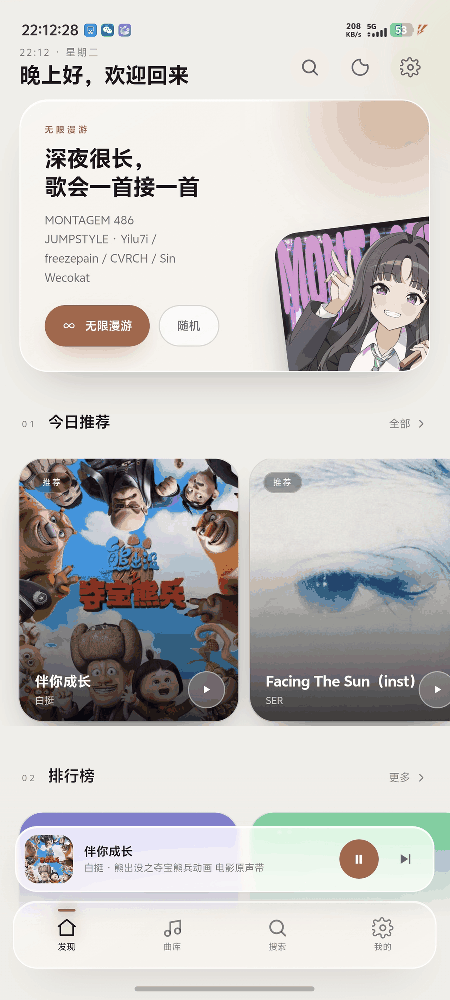

<h1 align="center">Ripple 涟漪</h1>

<p align="center">
  <b>一个会呼吸的音乐播放器</b><br>
  液态玻璃观感 · 深色 / 浅色双主题 · 封面自动取色
</p>

<p align="center">
  <b>Android 7.0+</b> · <b>Windows x64</b> · <b>Linux x64</b> · <b>浏览器 / PWA</b>
  <br>
  <b>APK 0.5 MB</b> · <b>无 Gradle</b> · <b>无 AndroidX</b> · <b>MIT</b>
</p>

<p align="center">
  <b>简体中文</b> | <a href="./docs/en/README_en.md">English</a> ·
  <a href="./CHANGELOG.md">更新记录</a> ·
  <a href="../../releases">下载</a>
</p>

---

## 这是什么

**Ripple（涟漪）是一个第三方网易云音乐客户端**，支持登录自己的账号，界面是自绘的液态玻璃风格。

三端共用同一个前端：**Android App（0.5 MB）· 浏览器 / PWA · 桌面端（Windows / Linux）**。

> 在线内容走网易云**真实 weapi 协议**（AES-128-CBC 双层 + textbook RSA），
> 不是抓公开接口凑合 —— 所以搜索、歌单、每日推荐、我喜欢的表现和官方一致。

## 为什么值得装

| | |
|---|---|
| **0.5 MB，没有 native 库** | 纯 Java + WebView，APK 里没有 `.so`，所有 CPU 架构共用一个包。装完不占空间，不需要分 ABI |
| **零依赖构建** | 不依赖 Gradle、没有 AndroidX、没有 npm、没有前端构建链。源码 clone 下来就能改、就能打包 |
| **歌词跟着声音走** | 四个歌词表面（状态栏浮层 / 展开整篇 / 收起三行 / 桌面小窗）都按**当前这一句**的进度实时染色 |
| **状态栏歌词能锁定** | 锁定态**完全不拦触摸**，盖在任何 App 上都不影响你正常用手机 |
| **断点续播连歌词一起恢复** | 退出再进来，歌、进度、歌词位置都在原地 |
| **桌面端逻辑与 APK 完全相同** | 复用同一份前端，用桥接层把 Android 接口原样造出来，不是另写一个 |

## 它长什么样

<table>
<tr>
<td align="center"><br><sub>首页 · 每日推荐</sub></td>
<td align="center"><br><sub>播放页 · 封面取色</sub></td>
<td align="center"><br><sub>完整歌词 · 卡拉OK染色</sub></td>
</tr>
<tr>
<td align="center"><br><sub>5 段均衡器</sub></td>
<td align="center"><br><sub>播放设置面板</sub></td>
<td align="center"><br><sub>状态栏歌词</sub></td>
</tr>
</table>

<p align="center">
  <br>
  <sub>通知栏与原子岛由系统按 MediaSession 渲染 · 真机 vivo V2425A / Android 17</sub>
</p>

## 下载安装

### Android（推荐）

到 **[Releases](../../releases)** 下载 `Ripple-x.y.z.apk`，传到手机安装（需允许「安装未知来源应用」）。

- 最低 **Android 7.0**（API 24）
- **只有一个通用包**，不用分 ABI —— 纯 Java + WebView，APK 内无任何 `.so`
- 装完直接可用，**不需要另起服务、不需要配接口地址**

> **安装来源很重要**：本 App 使用公开的 **debug 签名**（keystore 随仓库公开，密码是业界通用的
> `android`），任何人拿它都能签出同包名的 APK。请**只从本仓库 Releases 安装** ——
> 否则等于把「能覆盖升级你的 Ripple」的权限交给别人。详见 [SECURITY.md](SECURITY.md)。

### 桌面端（Windows / Linux）

同样在 **[Releases](../../releases)** 里，和 APK 放在一起：

| 平台 | 格式 | 说明 |
|---|---|---|
| Linux | `.deb` | Debian / Ubuntu 双击安装 |
| Linux | `.AppImage` | 免安装，`chmod +x` 后直接跑 |
| Linux | `.tar.gz` | 便携版，解压即用 |
| Windows | `-setup.exe` | NSIS 安装包 |
| Windows | `.zip` | 绿色版，解压即用 |

> 包**未做代码签名**（Windows 证书要花钱，本项目不做）。首次运行会被 SmartScreen 拦，
> 绕过方法写在 [desktop/README.md](desktop/README.md) —— **如实告知，而不是假装安全**。
>
> 桌面端没有通知栏媒体控制与系统托盘（计划做 MPRIS / SMTC），
> 也没有 macOS 版（需要 Apple SDK + 签名证书，无法产出也无法验证）。
> 完整对照表见 [desktop/README.md](desktop/README.md)。

### 网页版 / PWA

```bash
node server.js          # 默认 8080
```

终端会打印局域网地址，手机连同一 Wi-Fi 后访问 `http://<你的IP>:8080`，
浏览器菜单里「添加到主屏幕」即可全屏运行。

> 由 `server.js` 托管时页面自动走同源 `/ncm/*` 代理，**不需要手填接口地址**。
> 只有想连别的自建接口时才需要在「我的 → 网易云接口地址」里填。
>
> 用主机名访问也可以（`http://<主机名>.local:8080`，mDNS 与网卡 IP 同属白名单），
> 页面与 `/ncm/*` 接口走同一套 Host 判定，不会出现「页面能开、接口全 403」。

## 功能

<details open>
<summary><b>播放</b></summary>

- 三个 `<audio>` 元素架构：在线流走直连解码（避开 CORS 污染）、本机导入走 WebAudio（可接均衡器）、
  跨域直链单独一个不带 `crossOrigin` 的元素（第三方音频不返回 CORS 头，混用会被判加载失败）
- 多尺寸适配：小屏手机 / 常规手机 / 大屏手机 / 折叠屏 / 平板 / 桌面各有一套布局，支持小窗与分屏
- 淡入淡出、播放速度、睡眠定时（跨重启恢复）、无缝预加载、音量归一化
- 断点续播：退出后重进自动恢复上次的歌与进度，**歌词也会一起恢复**

</details>

<details open>
<summary><b>歌词</b></summary>

- **卡拉OK逐句染色**：当前这一句按本句的时间窗从左到右覆盖颜色，唱完的句子转成高亮色
- 四个表面都生效：状态栏浮层 · 展开的整篇 · 收起的三行 · 桌面端独立小窗
- 染色颜色可自定义（默认跟随主题，两套主题各自算过对比度）
- **换句有平滑过渡**：上一句上移淡出、下一句从下方浮入，高画质下带高斯模糊
- **歌词模糊**：展开的整篇里，非当前句按距离逐级加深高斯模糊（0.2 → 2px，
  按「还能看清字」这条线收，封顶 1.25px），高画质专属、可在设置与播放器面板开关
- 双语歌词（含翻译）、字号与偏移可调、长句跑马灯

</details>

<details open>
<summary><b>界面</b></summary>

- **界面语言：中文 / English**，可在「我的 → 界面语言」切换；以中文原文为词条，
  没翻译的地方自动回落中文，不会出现空文案或裸键名。英文有独立排版（行高、断词、
  小字字号），不是把中文直接替换掉
- 单一「液态玻璃」观感，不搞多套皮肤 —— 一套做透
- 玻璃强度 0 ~ 4 px（默认 2），按字面生效，要的是「通透」而不是「一堵墙」
- edge-to-edge 全屏（Android）：状态栏 / 导航栏透明，颜色跟着页面背景和封面主色走
- 播放页三行歌词（点开是完整歌词），封面动态取色，VIP 角标
- 右上角「…」是所有播放相关设置的入口，不必绕回「我的」
- 评论加载骨架屏，不闪不跳

</details>

<details open>
<summary><b>均衡器</b></summary>

- 5 段（60 / 230 / 910 / 3.6k / 14k Hz），6 组预设 + 自定义（±12 dB）
- 预设模式下竖条置灰不可动；切到「自定义」才能拖

> 均衡器只对**本机导入**的歌曲生效。在线流走直连解码（网易云 CDN 不返回 CORS 头，
> 强行接进 WebAudio 会被判污染并静音），播在线歌时面板会明确提示，不会假装有反应。

</details>

<details open>
<summary><b>通知与状态栏（Android 专属）</b></summary>

- 前台服务 + MediaSession：通知固定不可滑掉、锁屏可控、耳机键可控
- 状态栏歌词悬浮窗：颜色（含自绘取色器）、字号、不透明度、加粗、描边、**跟随播放进度填充**
- **锁定态完全不拦触摸**，不影响正常用手机；解锁后才能拖动位置

> 这三项依赖 Android 的窗口与媒体系统，浏览器和桌面端没有对等物。
> 桌面端用「独立置顶小窗」承担歌词浮层，但没有通知栏媒体控制。
> 桌面端在「设置 → 通知与后台」里会**自动隐藏**手机专属开关，
> 避免出现「能拨但什么都不会发生」的按钮。

</details>

<details open>
<summary><b>网易云</b></summary>

- 真实 weapi 协议（AES-128-CBC 双层 + textbook RSA，与主流第三方客户端一致）
- 扫码登录，登录态持久化
- 搜索、歌曲详情、歌词（含翻译）、播放地址自动降级、排行榜、歌单、
  每日推荐、我喜欢、心动模式、无限漫游、评论

</details>

## 不做什么

- **不内置任何音乐资源**，不提供下载站
- **不绕过会员、付费或地区限制**。取不到音源就明确告诉你取不到
- 不承诺通知栏长得像某个 App —— 外观由系统按 MediaSession 渲染，厂商主题说了算
- **不给桌面端做代码签名**：如实告知绕过方法，而不是假装安全

## 隐私

**没有自有服务器，不上传任何数据到第三方。** 所有网络请求只发往 `music.163.com` 及其 CDN。

| 数据 | 存在哪 |
|---|---|
| 网易云登录态 | APK：应用私有配置；浏览器模式：`.ripple-cookie`（服务端 `chmod 0600`，但 Android 外部存储不实现 POSIX 权限位，实际为 `660`，见下） |
| 本机导入的音频 | IndexedDB / 应用私有目录 |
| 播放记录、设置 | localStorage / SharedPreferences |
| 运行日志 | `Download/Ripple-log.txt`（不含密码） |

`.ripple-cookie`、`.ripple-token` 都在 `.gitignore` 里，不会被提交。

> **关于 0600 的说明**：本项目常跑在 `/sdcard/DSHBox/ripple`（Android 内部存储，
> fuseblk 挂载）。该挂载不实现 POSIX 权限位，`chmod 0600` 是空操作 ——
> 实测 `stat -c '%a' .ripple-cookie .ripple-token` 得到 `660` 而非 `0600`。
> 服务启动会读回文件 mode 校验，不符即打印醒目警告（所以你会看到这条警告，它是准确的）。
> 如果这台机器上还有其它 App 能读你的内部存储，请把项目移到应用私有目录再运行。

安全相关请读 [SECURITY.md](SECURITY.md)。

## 从源码构建

```bash
export ANDROID_HOME=/path/to/android-sdk
export JAVA_HOME=/path/to/jdk17+
bash android/build-apk.sh
```

产物：`android/build-manual/Ripple-<版本>-debug.apk`。
详细环境要求与 ARM 机器的坑见 [CONTRIBUTING.md](CONTRIBUTING.md#2-打包-apk)。

构建流程**不依赖 Gradle**（`build-apk.sh` 只用 `aapt2 / javac / d8`）。
仓库里保留了可选的 Gradle 配置（`android/build.gradle` 等），但它**不是**官方构建入口，
只用于 IDE 补全和给想用 Gradle 的人一个起点。

跑测试：`bash tests/run.sh`（Node 内置 test runner，不需要 `npm install`）。

## 项目结构

```
app/                    ← 网页版，同时是 APK 里的 assets/www（三端共用）
├── index.html
├── css/                ← base（令牌/主题/播放页）/ layouts / components / responsive
├── js/
│   ├── version.js      ← 构建时生成，勿手改
│   ├── log.js          ← 日志（含原生化）
│   ├── lrc.js          ← LRC 解析与双语合并
│   ├── lyricfill.js    ← 卡拉OK染色换算（纯函数，可单测）
│   ├── netease.js      ← 网易云客户端（native / proxy 双通道）
│   ├── qrcode.js       ← 二维码（扫码登录）
│   ├── perf.js         ← 低端机自动降画质
│   ├── store.js        ← 状态、本地曲库、IndexedDB
│   ├── player.js       ← 播放引擎
│   └── app.js          ← 界面与业务
└── sw.js               ← Service Worker

android/                ← Java 外壳（12 个类，见 CONTRIBUTING.md 的「代码结构」）
desktop/                ← 桌面端（Tauri），见 desktop/README.md
├── bridge.js           ← 把 RippleNative 桥照原样造出来，前端零改动
├── lyric.html          ← 独立置顶歌词小窗
├── build-frontend.sh   ← app/ + bridge.js + lyric.html → dist/（纯 bash，无 npm）
└── src-tauri/          ← Rust：weapi 加密 + 22 条网易云命令 + Tauri 入口
server.js               ← 浏览器模式的本地服务（静态 + /ncm 代理）
server-security.js      ← 上面那个服务的安全判定（Host / 同源 / 令牌 / 上游路径），可直接单测
version.json            ← 版本号唯一来源
tests/                  ← Node 内置测试（bash tests/run.sh）
```

三端共用同一份 `app/`：改前端只改这里，Android / 浏览器 / 桌面同时生效。

## 参与

欢迎提 issue 和 PR，动手前请先看 [CONTRIBUTING.md](CONTRIBUTING.md)。

**Android / 网页版**刻意不引入 Kotlin / AndroidX / npm 依赖 / 前端构建链 ——
这是它能保持「一个 `node server.js` 就跑起来」的前提。

**桌面端**（`desktop/`）打破了这一条：它需要 cargo 与 Rust 依赖树。
这是引入系统级客户端能力的必然代价，所以把它隔离在独立目录、独立 CI 里，
**不影响**前两端的零依赖构建。取舍写在 [desktop/README.md](desktop/README.md)。

## 许可证

[MIT](LICENSE)

---

<p align="center">
  <b>编码与文档</b>：Deepseek V4.1 Flash 1017<br>
  <b>主要审查</b>：MiniMax M3.1 Flash · Hy4 Flash · GLM-5.3 Flash · Deepseek V4.1 Flash 1017
</p>

<p align="center">
  <sub><b>免责声明</b>：本项目是第三方客户端，与网易云音乐官方无关。不提供任何音乐资源，
  不绕过会员与版权限制。在线内容的版权归网易云音乐及权利人所有，请仅收听你本身有权访问的内容。</sub>
</p>
