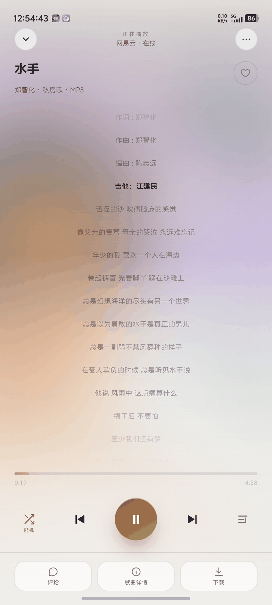

# Ripple 涟漪

**简体中文** | [English](./docs/en/README_en.md)

> 一个会呼吸的音乐播放器。液态玻璃单套观感，深色 / 浅色双主题，封面自动取色。
> 在线内容走网易云真实接口（weapi 加密），支持登录自己的账号、每日推荐、心动模式与无限漫游。

<p align="center">
  <b>PWA + 原生外壳</b> · <b>约 0.5 MB（APK）</b> · <b>构建不依赖 Gradle</b> · <b>无 AndroidX</b> · <b>MIT</b>
</p>

**平台**：Android（APK）· 浏览器 / PWA（`node server.js`）· 桌面端（Windows / Linux，Tauri 2）

> 桌面端复用**同一份 `app/` 前端，逻辑一行不改**，靠一层桥接把 Android 的
> `@JavascriptInterface` 原样造出来。详见 [desktop/README.md](desktop/README.md)。
>
> 桌面端产物目前只作为 Actions Artifacts 提供，**不进公开 Release**；
> macOS 不做（需要 Apple SDK + 签名证书，本机无法产出也无法验证）。

---

## 它长什么样

> **截图位于 `docs/screenshots/`，由维护者在发布前补充。**

| 首页 | 播放页 |
|:---:|:---:|
|  |  |

| 完整歌词 | 播放设置 |
|:---:|:---:|
|  |  |

| 均衡器 | 状态栏歌词 |
|:---:|:---:|
|  |  |


> 真机截图：vivo V2425A / Android 17。通知与原子岛由系统按 MediaSession 渲染。

## 特点

**播放**

- 三个 `<audio>` 元素架构：在线流走直连解码（避开 CORS 污染）、本机导入走 WebAudio（可接均衡器）、
  跨域直链单独一个不带 `crossOrigin` 的元素（第三方音频不返回 CORS 头，混用会被判加载失败）
- 多尺寸适配：小屏手机 / 常规手机 / 大屏手机 / 折叠屏 / 平板 / 桌面各有一套布局，支持小窗与分屏
- 淡入淡出、播放速度、睡眠定时（跨重启恢复）、无缝预加载、音量归一化
- 断点续播：退出后重进自动恢复上次的歌与进度，**歌词也会一起恢复**

**界面**

- 单一「液态玻璃」观感。不搞多套皮肤 —— 一套做透
- edge-to-edge 全屏（Android）：状态栏 / 导航栏透明，颜色跟着页面背景和封面主色走
- 播放页三行歌词（点开是完整歌词），封面动态取色，VIP 角标
- 右上角「…」是所有播放相关设置的入口，不必绕回「我的」
- 评论加载骨架屏，不闪不跳

**均衡器**

- 5 段（60 / 230 / 910 / 3.6k / 14k Hz），6 组预设 + 自定义（±12 dB）
- 预设模式下竖条置灰不可动；切到「自定义」才能拖

> 均衡器只对**本机导入**的歌曲生效。在线流走直连解码（网易云音频 CDN 不返回 CORS 头，
> 强行接进 WebAudio 会被判污染并静音），播在线歌时面板会明确提示，不会假装有反应。

**通知与状态栏**（Android 专属）

- 前台服务 + MediaSession：通知固定不可滑掉、锁屏可控、耳机键可控
- 状态栏歌词悬浮窗：颜色（含自绘取色器）、字号、不透明度、加粗、描边、
  **跟随播放进度填充**
- **锁定态完全不拦触摸**，不影响你正常用手机；解锁后才能拖动位置

> 这三项依赖 Android 的窗口与媒体系统，浏览器和桌面端没有对等物。
> 桌面端**没有**通知栏媒体控制与歌词浮层（计划做系统托盘 / MPRIS，
> 见 [desktop/README.md](desktop/README.md) 的功能对照表）。
>
> 因此桌面端在「设置 → 通知与后台」里会**自动隐藏**这四项手机专属开关
> （通知栏播放控件 / 通知不打断播放 / 发送测试通知 / 请求通知权限），
> 避免出现「能拨但什么都不会发生」的开关。「软件内通知」是纯前端 toast，
> 桌面端照样有效，保留。

**网易云**

- 真实 weapi 协议（AES-128-CBC 双层 + textbook RSA，与主流第三方客户端一致）
- 内置登录页（扫码 / 账号密码），登录态持久化
- 搜索、歌曲详情、歌词（含翻译）、播放地址自动降级、排行榜、歌单、
  每日推荐、我喜欢、心动模式、无限漫游、评论

## 不做什么

为了不给自己惹麻烦，这些不做：

- **不内置任何音乐资源**，不提供下载站
- **不绕过会员、付费或地区限制**。取不到音源就明确告诉你取不到
- 不承诺通知栏长得像某个 App —— 外观由系统按 MediaSession 渲染，厂商主题说了算
- **不给桌面端做代码签名**：Windows / macOS 的签名证书要花钱，本项目不做。
  所以桌面端包首次运行会被系统拦（Windows SmartScreen / macOS Gatekeeper），
  绕过方法写在 [desktop/README.md](desktop/README.md) 里 ——
  如实告知，而不是假装安全

## 安装

### 装 APK（推荐）

到 [Releases](../../releases) 下载最新的 `Ripple-x.y.z.apk`，传到手机安装（需允许「安装未知来源应用」）。

**只有一个通用包，不需要分 ABI。** Ripple 是纯 Java + WebView 应用，
APK 里没有任何 `.so` / `lib/` 目录（`aapt2 dump badging` 也没有 `native-code` 字段），
所以 x86 / x86_64 / arm64 用的是同一个包 —— 那些 ABI 只对带 native 库的应用才有意义。

### 桌面端（Windows / Linux）

产物在 Actions 的 `ripple-desktop-linux-x64` / `ripple-desktop-windows-x64` 里：

| 平台 | 格式 | 说明 |
|---|---|---|
| Linux | `.deb` | Debian / Ubuntu 双击安装 |
| Linux | `.AppImage` | 免安装，`chmod +x` 后直接跑 |
| Linux | `.tar.gz` | 便携版，解压即用 |
| Windows | NSIS `-setup.exe` | 安装包 |
| Windows | `.zip` | 绿色版，解压即用 |

包未做代码签名，首次运行会被系统拦（Windows SmartScreen / Linux 无影响），
绕过方法见 [desktop/README.md](desktop/README.md)。

- 最低 Android 7.0（API 24）
- 装完直接可用，**不需要另起服务、不需要配置接口地址**

> **安装来源很重要**：本 App 使用公开的 **debug 签名**（debug keystore 随仓库公开，
> 密码是业界通用的 `android`，任何人都能拿它签出同包名的 APK）。因此请**只从本仓库
> Releases 安装**，不要安装其它来源的同包名 APK —— 否则等于把「能覆盖升级你的 Ripple」
> 的权限交给别人。详见 [SECURITY.md](SECURITY.md)。

### 跑网页版 / PWA

```bash
node server.js          # 默认 8080
```

终端会打印局域网地址，手机连同一 Wi-Fi 后访问 `http://<你的IP>:8080`，
浏览器菜单里「添加到主屏幕」，即可全屏运行。

> 由 `server.js` 托管时页面自动走同源 `/ncm/*` 代理，**不需要手填接口地址**。
> 只有想连别的自建接口时才需要在「我的 → 网易云接口地址」里填。
>
> 用主机名访问也可以（`http://<主机名>.local:8080`，mDNS 与网卡 IP 同属白名单），
> 页面与 `/ncm/*` 接口走同一套 Host 判定，不会出现「页面能开、接口全 403」。
>
> ⚠️ 安全边界是「防局域网里的网页跨站打你的接口」，**不是「防本机上已经拿到同等权限的程序」**：
> 同机程序可以伪造请求头取到短期令牌（也能直接读 `.ripple-cookie`）。
> 详见 [SECURITY.md](SECURITY.md) 的「已知限制」一节。

### 从源码构建

```bash
export ANDROID_HOME=/path/to/android-sdk
export JAVA_HOME=/path/to/jdk17+
bash android/build-apk.sh
```

产物：`android/build-manual/Ripple-<版本>-debug.apk`。
详细的环境要求与 ARM 机器的坑见 [CONTRIBUTING.md](CONTRIBUTING.md#2-打包-apk)。

构建流程不依赖 Gradle（`build-apk.sh` 只用 `aapt2 / javac / d8`，见
[android/build-apk.sh](android/build-apk.sh)）；仓库里保留了可选的 Gradle 配置
（`android/build.gradle`、`android/settings.gradle`、`android/gradle.properties`、
`android/app/build.gradle`），但它**不是**官方构建入口，只用于 IDE 补全和给想用
Gradle 的人一个起点。

## 项目结构

```
app/                    ← 网页版，同时是 APK 里的 assets/www
├── index.html
├── css/                ← base（令牌/主题/播放页）/ layouts / components
├── js/
│   ├── version.js      ← 构建时生成，勿手改
│   ├── log.js          ← 日志（含原生化）
│   ├── lrc.js          ← LRC 解析与双语合并
│   ├── netease.js      ← 网易云客户端（native / proxy 双通道）
│   ├── store.js        ← 状态、本地曲库、IndexedDB
│   ├── player.js       ← 播放引擎
│   └── app.js          ← 界面与业务
└── sw.js               ← Service Worker

android/                ← Java 外壳（11 个类，见 CONTRIBUTING.md 的「代码结构」）
desktop/                ← 桌面端（Tauri）—— 验证中，见 desktop/README.md
├── bridge.js           ← 把 RippleNative 桥照原样造出来，前端零改动
├── build-frontend.sh   ← app/ + bridge.js → dist/（纯 bash，无 npm）
└── src-tauri/          ← Rust：weapi 加密 + 20 个网易云命令 + Tauri 入口
server.js               ← 浏览器模式的本地服务（静态 + /ncm 代理）
server-security.js      ← 上面那个服务的安全判定（Host / 同源 / 令牌 / 上游路径），可直接单测
version.json            ← 版本号唯一来源
tests/                  ← Node 内置测试（bash tests/run.sh）：LRC 解析 + server 安全判定
```

三端共用同一份 `app/`：改前端只改这里，Android / 浏览器 / 桌面同时生效。

## 隐私

**没有自有服务器，不上传任何数据到第三方。** 所有网络请求只发往 `music.163.com` 及其 CDN。

| 数据 | 存在哪 |
|---|---|
| 网易云登录态 | APK：应用私有配置；浏览器模式：`.ripple-cookie`（服务端会 `chmod 0600`，但 Android 外部存储不实现 POSIX 权限位，实际为 `660`，见下） |
| 本机导入的音频 | IndexedDB / 应用私有目录 |
| 播放记录、设置 | localStorage / SharedPreferences |
| 运行日志 | `Download/Ripple-log.txt`（不含密码） |

`.ripple-cookie`、`.ripple-token` 都在 `.gitignore` 里，不会被提交。

> **关于 0600 的说明**：本项目常跑在 `/sdcard/DSHBox/ripple`（Android 内部存储，
> fuseblk 挂载）。该挂载不实现 POSIX 权限位，`chmod 0600` 是空操作 ——
> 实测 `stat -c '%a' .ripple-cookie .ripple-token` 得到的是 `660`，不是 `0600`。
> 服务启动时会读回文件 mode 校验，不符即打印醒目警告（所以你会看到这条警告，它是准确的）。
> 如果这台机器上还有其它 App 能读你的内部存储，请把项目移到应用私有目录再运行。

安全相关请读 [SECURITY.md](SECURITY.md)。

## 参与

欢迎提 issue 和 PR，动手前请先看 [CONTRIBUTING.md](CONTRIBUTING.md)。
**Android / 网页版**刻意不引入 Kotlin / AndroidX / npm 依赖 / 前端构建链 ——
这是它能保持「一个 `node server.js` 就跑起来」的前提。

**桌面端**（`desktop/`，验证中）打破了这一条：它需要 cargo 与 Rust 依赖树。
这是引入系统级客户端能力的必然代价，所以把它隔离在独立目录、独立 CI 里，
**不影响**前两端的零依赖构建。取舍写在 [desktop/README.md](desktop/README.md)。

跑测试：`bash tests/run.sh`（Node 内置 test runner，不需要 `npm install`）。

## 许可证

[MIT](LICENSE)

## 参与贡献

**编码**：Deepseek V4.1 Flash 1017  
**主要审查**：MiniMax M3.1 Flash、Hy4 Flash、GLM-5.3 Flash

---

**免责声明**：本项目是第三方客户端，与网易云音乐官方无关。不提供任何音乐资源，不绕过会员与版权限制。
在线内容的版权归网易云音乐及权利人所有，请仅收听你本身有权访问的内容。
