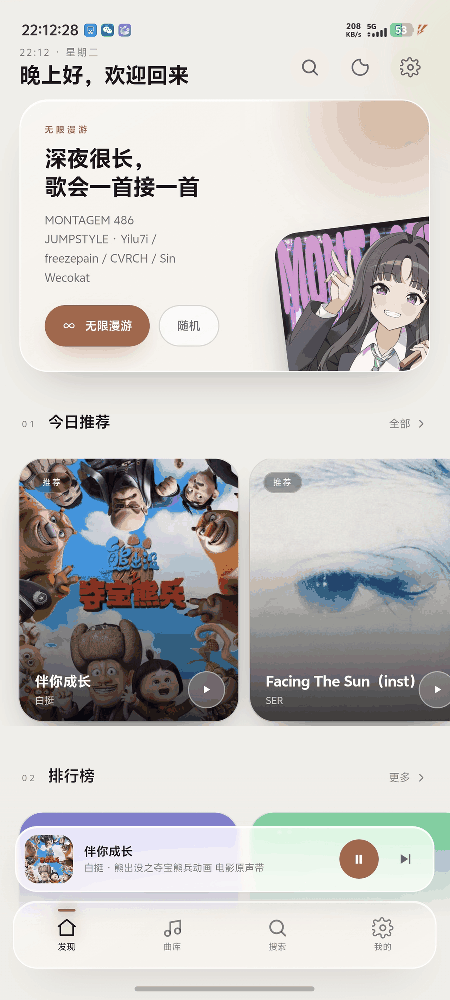
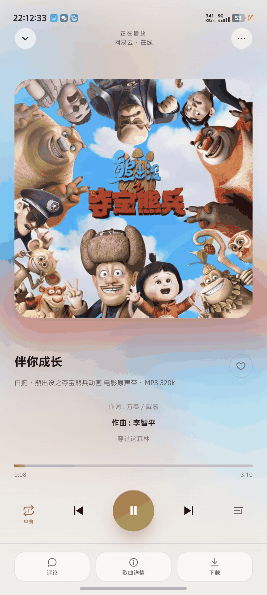
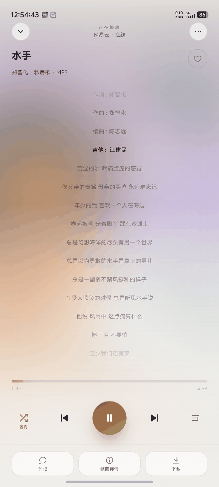
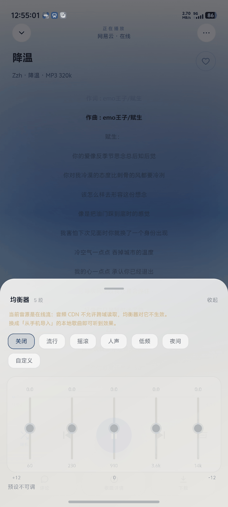
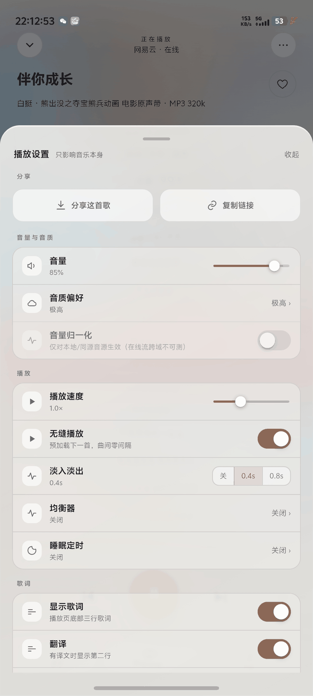
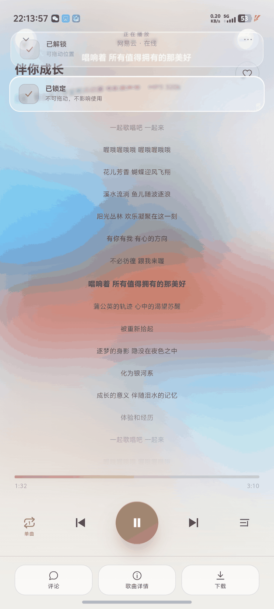
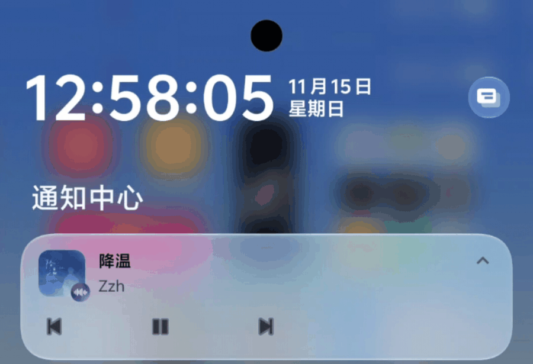

<h1 align="center">Ripple</h1>

<p align="center">
  <b>A music player that breathes</b><br>
  Liquid-glass visuals · dark / light themes · automatic cover art colour extraction
</p>

<p align="center">
  <b>Android 7.0+</b> · <b>Windows x64</b> · <b>Linux x64</b> · <b>browser / PWA</b>
  <br>
  <b>APK 0.5 MB</b> · <b>no Gradle</b> · <b>no AndroidX</b> · <b>MIT</b>
</p>

<p align="center">
  <a href="../../README.md">简体中文</a> | <b>English</b> ·
  <a href="./CHANGELOG_en.md">Changelog</a> ·
  <a href="../../../releases">Download</a>
</p>

---

## What this is

**Ripple is a third-party NetEase Cloud Music client.** Log in with your own account;
the interface is a hand-drawn liquid-glass design.

All three platforms share one frontend: **Android app (0.5 MB) · browser / PWA ·
desktop (Windows / Linux)**.

> Online content goes through NetEase's **real weapi protocol** (double AES-128-CBC plus
> textbook RSA), not a scrape of public endpoints — so search, playlists, Daily
> Recommendations and My Likes behave the same as the official client.

## Why it is worth installing

| | |
|---|---|
| **0.5 MB, zero native libraries** | Pure Java + WebView; there is no `.so` in the APK, so one package covers every CPU architecture |
| **Zero-dependency build** | No Gradle, no AndroidX, no npm, no frontend build chain. Clone it, change it, package it |
| **Lyrics that follow the music** | All four lyric surfaces (status-bar overlay / expanded view / collapsed three lines / desktop mini window) colour in real time by **the current line's** progress |
| **A status-bar lyric you can lock** | When locked it **does not intercept touch at all**, so it never gets in the way of using the phone |
| **Resume restores lyrics too** | Quit and reopen: the song, the position and the lyric line are all where you left them |
| **Desktop runs the exact same logic** | It reuses the same frontend through a bridge layer that reproduces the Android interface verbatim — not a second implementation |

## What it looks like

<table>
<tr>
<td align="center"><br><sub>Home · Daily Recommendations</sub></td>
<td align="center"><br><sub>Player · cover colour extraction</sub></td>
<td align="center"><br><sub>Full lyrics · karaoke colouring</sub></td>
</tr>
<tr>
<td align="center"><br><sub>5-band equalizer</sub></td>
<td align="center"><br><sub>Playback settings panel</sub></td>
<td align="center"><br><sub>Status-bar lyric</sub></td>
</tr>
</table>

<p align="center">
  <br>
  <sub>Notification and Atomic Island are rendered by the system via MediaSession · real device vivo V2425A / Android 17</sub>
</p>

## Download

### Android (recommended)

Grab `Ripple-x.y.z.apk` from **[Releases](../../../releases)** and install it on the phone
(you will need to allow "install from unknown sources").

- Requires **Android 7.0** (API 24) or newer
- **One universal package, no ABI split** — pure Java + WebView, no `.so` inside
- Works immediately after install: **no server to start, no API address to configure**

> **Install source matters**: this app uses a **public debug signature** (the keystore is
> in the repository and the password is the universal `android`), so anyone can sign an APK
> with the same package name. Please install **only from this repository's Releases** —
> otherwise you hand someone else the ability to overwrite and upgrade your Ripple.
> Details in [SECURITY_en.md](./SECURITY_en.md).

### Desktop (Windows / Linux)

Also in **[Releases](../../../releases)**, next to the APK:

| Platform | Format | Notes |
|---|---|---|
| Linux | `.deb` | Double-click to install on Debian / Ubuntu |
| Linux | `.AppImage` | Portable; `chmod +x` and run |
| Linux | `.tar.gz` | Portable archive; extract and run |
| Windows | `-setup.exe` | NSIS installer |
| Windows | `.zip` | Portable; extract and run |

> The packages are **not code-signed** (a Windows certificate costs money and this project
> does not buy one). SmartScreen will block the first run; the bypass is documented in
> [desktop/README_en.md](../../desktop/README_en.md) — **told honestly, not papered over**.
>
> The desktop build has no notification media controls and no system tray (MPRIS / SMTC is
> planned), and there is no macOS build (it needs the Apple SDK and signing certificates,
> which cannot be produced or verified here). Full comparison in
> [desktop/README_en.md](../../desktop/README_en.md).

### Browser / PWA

```bash
node server.js          # port 8080, loopback only by default
node server.js --lan    # add this when a phone needs to connect
```

By default it listens on `127.0.0.1` only; open `http://localhost:8080` in a local browser.

To let a **phone** connect, add `--lan` (or set `RIPPLE_LAN=1`). The terminal then prints your
LAN address; point the phone at `http://<your-ip>:8080` on the same Wi-Fi and use
"Add to Home Screen" for a fullscreen experience.

> **Why LAN is off by default**: this service acts with your NetEase login state — it can read
> and write the account (change likes, post comments, log out). Token issuance can only be
> gated on headers like `Sec-Fetch-*` that **any client can forge**, and since tokens are bound
> to the source IP, a device on the same network can both obtain and use one. Exposing the
> service beyond this machine therefore has to be your explicit choice.
> See [SECURITY.md](SECURITY_en.md) for details.

> When served by `server.js` the page automatically uses the same-origin `/ncm/*` proxy, so
> **no API address needs to be filled in**. That is only needed if you want to point at a
> different self-hosted API ("My → NetEase API address").
>
> Hostnames work too (`http://<host>.local:8080`; mDNS and NIC IPs are both allow-listed),
> and the page and `/ncm/*` share one Host check, so you never get "the page opens but every
> API call 403s".

## Features

<details open>
<summary><b>Playback</b></summary>

- Three `<audio>` element architecture: online streams decode directly (avoiding CORS
  tainting), local imports go through WebAudio (so the equalizer applies), and cross-origin
  direct links get their own element without `crossOrigin` (third-party audio returns no CORS
  headers, and mixing them fails to load)
- Multi-size layouts: small / regular / large phones, foldables, tablets and desktop each get
  their own layout; floating windows and split-screen are supported
- Fade in/out, playback speed, sleep timer (restored across restarts), gapless preloading,
  volume normalisation
- Resume: the last song, position **and lyric line** are restored on reopen

</details>

<details open>
<summary><b>Lyrics</b></summary>

- **Per-line karaoke colouring**: the current line is covered left-to-right by its own time
  window, and finished lines turn into the highlight colour
- Works on all four surfaces: status-bar overlay · expanded full view · collapsed three
  lines · desktop standalone window
- The colouring colour is customisable (follows the theme by default; both themes are
  contrast-checked)
- **Smooth line transitions**: the previous line drifts up and fades out while the next one
  floats in from below, with gaussian blur on high quality
- **Lyric blur**: in the expanded view, lines blur progressively with distance from the
  current one (0.2 → 1.25px, bounded so text stays readable). High quality only, toggleable
  in settings and the player panel
- Bilingual lyrics with translations, adjustable font size and offset, marquee for long lines

</details>

<details open>
<summary><b>Interface</b></summary>

- **UI language: Chinese / English**, switchable under "Me → Interface language". The
  dictionary is keyed by the Chinese source string, so anything untranslated falls back to
  Chinese instead of showing an empty string or a bare key. English gets its own typography
  (line height, word breaking, small-text size) rather than a blind string swap
- A single "liquid glass" language — one set done thoroughly, not several skins
- Glass intensity 0–4 px (default 2), taken literally: glass should be see-through, not a wall
- Edge-to-edge on Android: status and navigation bars are transparent and follow the page
  background and the cover's dominant colour
- Three lyric lines on the player page (tap for the full view), dynamic cover colour
  extraction, VIP badge
- The "…" in the top-right is the entry point for every playback-related setting — no need to
  go back to "My"
- Skeleton screens while comments load: no flashing, no jumping

</details>

<details open>
<summary><b>Equalizer</b></summary>

- 5 bands (60 / 230 / 910 / 3.6k / 14k Hz), 6 presets plus custom (±12 dB)
- In preset mode the sliders are greyed out; switch to "Custom" to drag them

> The equalizer only applies to **locally imported** tracks. Online streams decode directly
> (the NetEase CDN returns no CORS headers, so routing them through WebAudio would be
> tainted and silenced); the panel says so explicitly instead of pretending to work.

</details>

<details open>
<summary><b>Notification and status bar (Android only)</b></summary>

- Foreground service + MediaSession: a pinned notification, lock-screen controls, headset
  button support
- Status-bar lyric overlay: colour (with a hand-drawn colour picker), font size, opacity,
  bold, outline, and **fill that follows playback progress**
- **Locked mode does not intercept touch at all**, so it never gets in the way; unlock it to
  drag the overlay around

> These three rely on Android window and media APIs with no desktop or browser equivalent.
> The desktop build uses a **standalone always-on-top mini window** for lyrics but has no
> notification media controls. On desktop the phone-only switches are **hidden automatically**
> so you never see a toggle that does nothing.

</details>

<details open>
<summary><b>NetEase Cloud Music</b></summary>

- Real weapi protocol (double AES-128-CBC plus textbook RSA, matching mainstream
  third-party clients)
- QR login, with the session persisted
- Search, track details, lyrics (with translations), automatic quality fallback, charts,
  playlists, Daily Recommendations, My Likes, Heartbeat Mode, Infinite Roam, comments

</details>

## What this does not do

- **No music is bundled**, and there is no download site
- **No bypassing of membership, paid content or regional restrictions.** If a source cannot
  be fetched, it says so
- No promise that the notification looks like some particular app — the system renders it
  from MediaSession, so the OEM theme decides
- **No code signing for the desktop packages**: the bypass is documented honestly rather than
  pretending the packages are safe

## Privacy

**There is no server of our own, and no data is uploaded to any third party.** Every network
request goes to `music.163.com` and its CDN.

| Data | Where it lives |
|---|---|
| NetEase session | APK: private app config; browser mode: `.ripple-cookie` (the server `chmod 0600`s it, but Android external storage does not implement POSIX permission bits, so it is actually `660` — see below) |
| Locally imported audio | IndexedDB / private app directory |
| Play history and settings | localStorage / SharedPreferences |
| Runtime log | `Download/Ripple-log.txt` (contains no passwords) |

`.ripple-cookie` and `.ripple-token` are both in `.gitignore` and never committed.

> **About the 0600 note**: this project usually runs from `/sdcard/DSHBox/ripple` (Android
> internal storage, a fuseblk mount). That mount does not implement POSIX permission bits, so
> `chmod 0600` is a no-op — measuring `stat -c '%a' .ripple-cookie .ripple-token` yields `660`,
> not `0600`. The server reads the mode back at startup and prints a loud warning when it does
> not match (so if you see that warning, it is accurate). If other apps on the machine can read
> your internal storage, move the project into a private app directory before running it.

Security details in [SECURITY_en.md](./SECURITY_en.md).

## Building from source

```bash
export ANDROID_HOME=/path/to/android-sdk
export JAVA_HOME=/path/to/jdk17+
bash android/build-apk.sh
```

Output: `android/build-manual/Ripple-<version>-debug.apk`.
Environment requirements and the ARM machine pitfalls are in
[CONTRIBUTING_en.md](./CONTRIBUTING_en.md#2-building-the-apk).

The build **does not use Gradle** (`build-apk.sh` only calls `aapt2 / javac / d8`). Optional
Gradle configuration (`android/build.gradle` and friends) is kept for IDE completion and as a
starting point for anyone who wants Gradle, but it is **not** the official build entry point.

Run the tests: `bash tests/run.sh` (Node's built-in test runner, no `npm install` needed).

## Project layout

```
app/                    ← the web app, and the APK's assets/www (shared by all three platforms)
├── index.html
├── css/                ← base (tokens/themes/player) / layouts / components / responsive
├── js/
│   ├── version.js      ← generated at build time, do not edit
│   ├── log.js          ← logging (with a native sink)
│   ├── lrc.js          ← LRC parsing and bilingual merging
│   ├── lyricfill.js    ← karaoke fill maths (pure functions, unit-tested)
│   ├── netease.js      ← NetEase client (native / proxy channels)
│   ├── qrcode.js       ← QR codes (for QR login)
│   ├── perf.js         ← automatic quality reduction on low-end devices
│   ├── store.js        ← state, local library, IndexedDB
│   ├── player.js       ← playback engine
│   └── app.js          ← UI and behaviour
└── sw.js               ← Service Worker

android/                ← Java shell (11 classes; see CONTRIBUTING_en.md)
desktop/                ← desktop client (Tauri); see desktop/README_en.md
├── bridge.js           ← reproduces the RippleNative bridge, so the frontend needs no change
├── lyric.html          ← standalone always-on-top lyric window
├── build-frontend.sh   ← app/ + bridge.js + lyric.html → dist/ (pure bash, no npm)
└── src-tauri/          ← Rust: weapi crypto + 22 NetEase commands + Tauri entry
server.js               ← local server for browser mode (static + /ncm proxy)
server-security.js      ← its security checks (Host / same-origin / token / upstream path), unit-testable
version.json            ← the single source of truth for the version number
tests/                  ← Node built-in tests (bash tests/run.sh)
```

All three platforms share one `app/`: change the frontend here and Android, the browser and
desktop all pick it up.

## Contributing

Issues and PRs are welcome; please read [CONTRIBUTING_en.md](./CONTRIBUTING_en.md) first.

**Android / web** deliberately avoid Kotlin, AndroidX, npm dependencies and a frontend build
chain — that is what keeps "one `node server.js` and it runs" true.

**Desktop** (`desktop/`) breaks that rule: it needs cargo and a Rust dependency tree. That is
the unavoidable cost of system-level client capabilities, so it is isolated in its own
directory and its own CI and **does not affect** the zero-dependency builds of the other two.
The trade-off is written up in [desktop/README_en.md](../../desktop/README_en.md).

## Licence

[MIT](../../LICENSE)

---

<p align="center">
  <b>Code and documentation</b>: Deepseek V4.1 Flash 1017<br>
  <b>Review</b>: MiniMax M3.1 Flash · Hy4 Flash · GLM-5.3 Flash · Deepseek V4.1 Flash 1017
</p>

<p align="center">
  <sub><b>Disclaimer</b>: this is a third-party client, not affiliated with NetEase Cloud
  Music. No music is provided and no membership or copyright restrictions are bypassed.
  Online content remains the property of NetEase Cloud Music and the rights holders; please
  listen only to content you are entitled to access.</sub>
</p>
